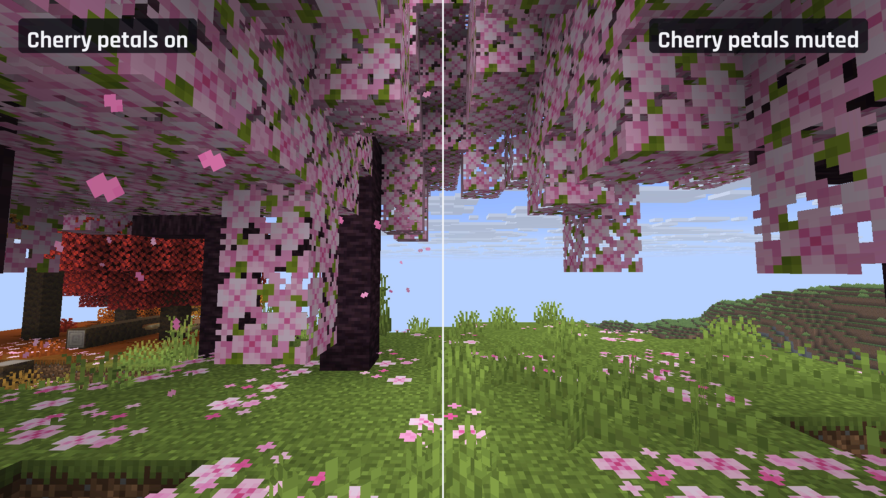
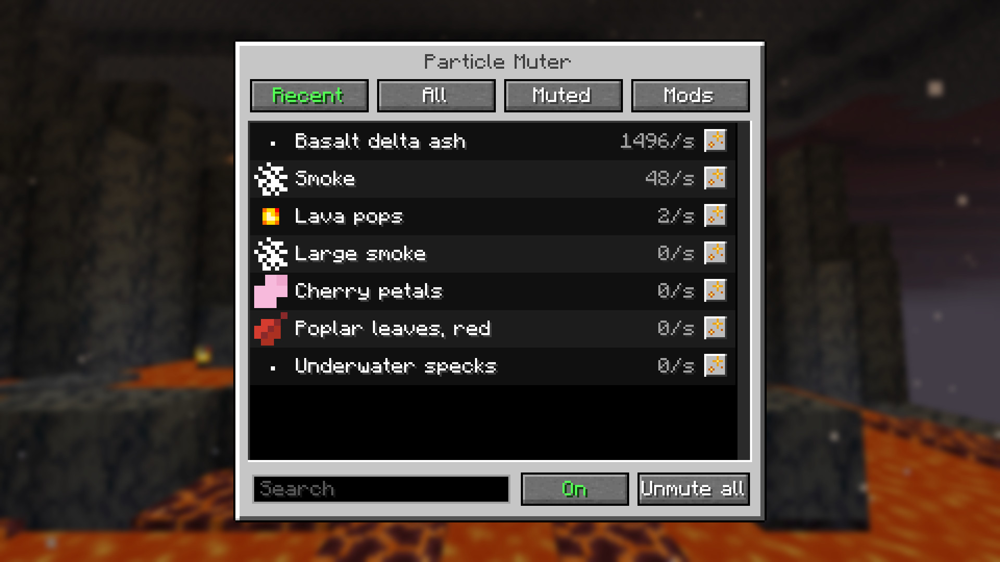
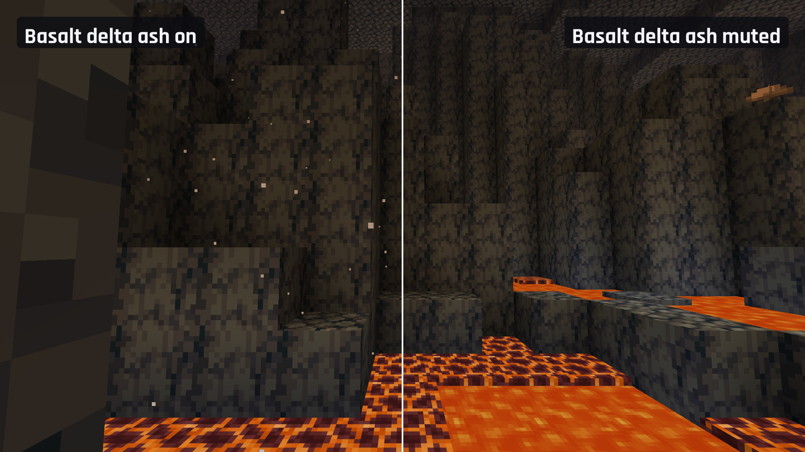
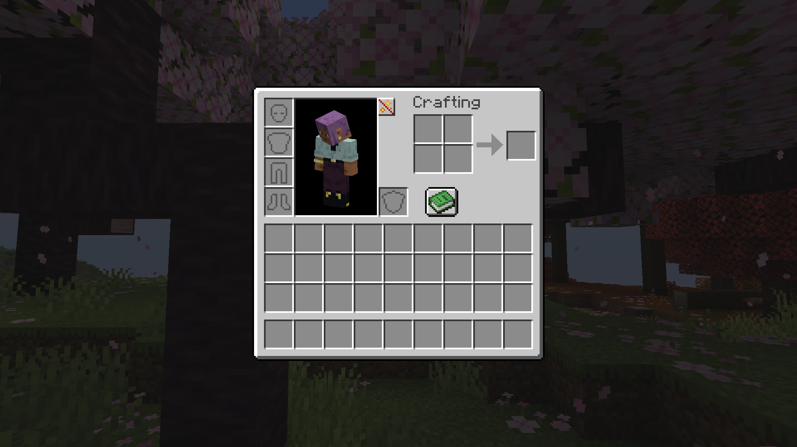

# Particle Muter

**Turn off any particle, from Minecraft or any mod, from a button in your inventory.**

Open your inventory and click the small button at the top right of the player's box. Every particle in the game is
listed with its picture, its name and how many are being made around you each second. Click one to mute it: it stops
being drawn at once, and stays off until you turn it back on.

**NeoForge** for Minecraft **26.3**, **26.1.2** and **1.21.1** · **Forge** for **1.20.1** · client-side only

## The lists

- **Recent:** the particles made around you lately, the busiest first. Whatever is filling your screen is at the top.
- **All:** every particle, Minecraft's and each mod's, under its mod's name. A mod's heading mutes all of its particles
  at once.
- **Muted:** what you turned off.
- **Mods:** one row per mod, to mute or unmute a whole mod.

Search by name, id or mod. **On / Off** shows every particle again for a while without losing your list, and
**Unmute all** clears it (click twice).

## The Nether's ash, gone

One click on **Basalt delta ash** clears the air of the Nether's busiest biome; the same for the soul sand valley's ash, the crimson and warped forests' spores, and any mod's particles.

## Not just particle types

Three more rows cover particles that have no type of their own:

- **Block breaking:** the bits of a block as it breaks.
- **Block mining:** the bits flying off a block while you mine it.
- **Item pickup:** items and orbs flying to whoever picks them up.

## The button

The button sits where Extreme Sound Muffler puts its own, or just below it when that mod is installed too. In creative
it shows on the inventory tab. It moves with the recipe book, and you can drag it somewhere else with the right mouse
button. There's also a key for the list (unbound at first: Controls, Misc) and the **Config** button in the mod list.

## Works with

- **Shader packs:** Iris with Sodium (NeoForge), Oculus with Embeddium (Forge 1.20.1).
- **Sodium Extra** and **Rubidium Extra**, which have particle switches of their own; both can be used at once.
- **Distant Horizons**.
- **Resource packs:** the list shows each particle as your pack draws it, high-resolution packs included.
- **Extreme Sound Muffler:** the two buttons sit together.

## FAQ

- **Does the server need it?** No. It's client-side only and works on any server.
- **Where are my choices kept?** In `config/particlemuter.json`, so they last across worlds and servers.
- **Will it slow my game?** No. Checking a particle is a single flag, and muted particles are never drawn, so it can
  only save work.
- **Forge or Fabric?** NeoForge on 26.3, 26.1.2 and 1.21.1; Forge on 1.20.1. No Fabric.

## Download

On CurseForge (Files tab), one jar for each Minecraft version:

| Minecraft | Loader | File |
|---|---|---|
| 26.3 | NeoForge | `particlemuter-1.0.0.jar` |
| 26.1.2 | NeoForge | `particlemuter-mc26.1.2-1.0.0.jar` |
| 1.21.1 | NeoForge | `particlemuter-mc1.21.1-1.0.0.jar` |
| 1.20.1 | Forge | `particlemuter-mc1.20.1-1.0.0.jar` |

## Source

`main` is Minecraft 26.3; the branches `26.1.2`, `1.21.1` and `1.20.1` are the other versions. Build with
`./gradlew build` (JDK 25 for 26.x, 21 for 1.21.1, 17 for 1.20.1).

## Licence

MIT. See [LICENSE](LICENSE).
