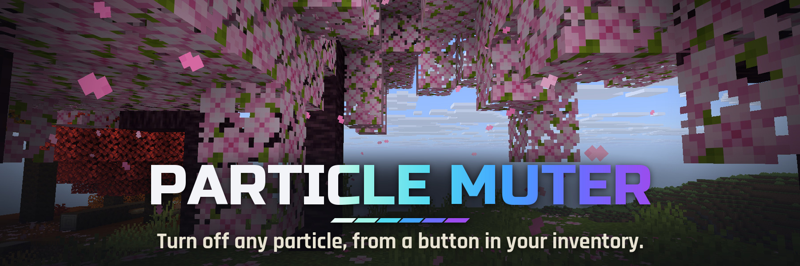

# Particle Muter

Turn off any particle, from Minecraft or any mod, from a button in your inventory.

Open your inventory and click the small button at the top right of the player's box. Every particle in the game is
listed with its picture, its name and how many are being made around you each second. Click one to mute it: it stops
being drawn at once, and stays off until you turn it back on.

- **Recent**: the particles made around you lately, the busiest first. Standing next to whatever is filling your
  screen, it is at the top.
- **All**: every particle, Minecraft's and each mod's, under its mod's name. A mod's heading mutes all of its
  particles at once.
- **Muted**: what you turned off.
- **Mods**: one row per mod, to mute or unmute a whole mod.
- **Search** by name, id or mod. **On / Off** shows every particle again for a while without losing your list.
- Three more rows for particles that have no type of their own: block breaking, block mining and item pickup.

The button sits where Extreme Sound Muffler puts its own, or just below it when that mod is installed too. Drag it with
the right mouse button to put it somewhere else. There is also a key for the list (unbound at first: Controls, Misc)
and the Config button in the mod list.

Particle Muter is client-side only: it changes nothing on servers, and works on any server. Your choices are kept in
`config/particlemuter.json`.

## Works with

- **Shader packs**: Iris with Sodium (NeoForge), Oculus with Embeddium (Forge 1.20.1). Muted particles stay gone with
  a shader pack on, and the list draws over it as normal.
- **Sodium Extra** and **Rubidium Extra**, which have particle switches of their own: both can be used at once.
- **Distant Horizons**.
- **Resource packs**: the list shows each particle as your pack draws it, high-resolution packs included.
- **Extreme Sound Muffler**: the two buttons sit together in the inventory.

## Versions

| Minecraft | Loader |
|---|---|
| 26.3 | NeoForge |
| 26.1.2 | NeoForge |
| 1.21.1 | NeoForge |
| 1.20.1 | Forge |

## Licence

MIT. See [LICENSE](LICENSE).
